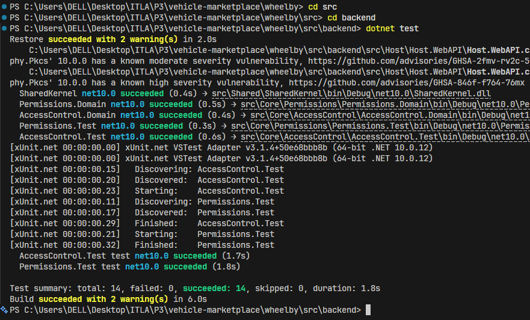
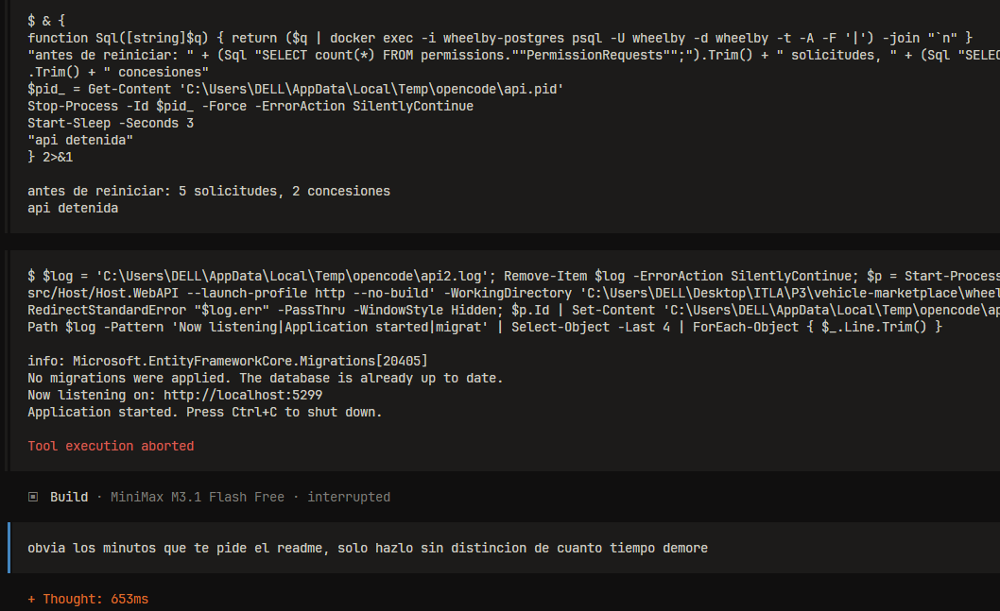
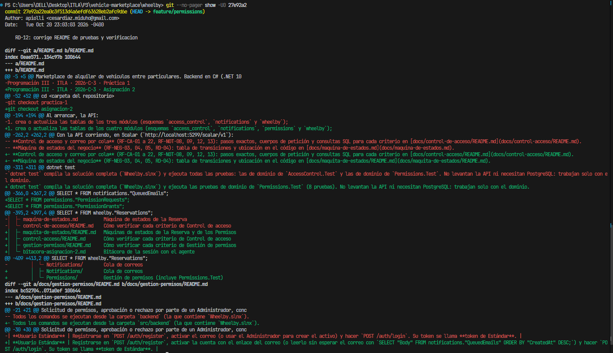

# Bitácora de sesión con el agente — Asignación 2

Fecha de la sesión: 20 de octubre de 2026. Rama: `feature/permissions`.
Herramienta: opencode, modo **Build**, modelo MiniMax M3.1 Flash.

## 1. Qué se pidió

Trabajé con dos agentes:

1. **Agente de planificación.** Le pedí que, a partir del enunciado de la asignación y del repositorio, preparara un encargo para el agente que iba a implementar. Devolvió el documento `Permissions-brief-agente.md`, con el diseño ya decidido: estructura del módulo, dominio y máquina de estados, casos de uso, rutas, las 8 pruebas, la documentación, el formato de los commits y, en su sección 10, un orden de trabajo **con tiempos estimados**:

   ```
   1. Dominio, máquina de estados y pruebas (commits 1–8): ~45 min.
   2. Contracts y Application (9–16): ~60 min.
   3. Infraestructura, migración, endpoints y Host (17–22): ~60 min.
   4. Documentación (23–25): ~30 min.
   ```

2. **Agente de construcción** (opencode, modo Build). Le entregué ese documento y le pedí implementar la pieza Gestión de permisos completa, con sus pruebas y su documentación:

   > Entonces con lo que tenemos ya planeado, recuerda que el core no toca ni sabe nada del dominio y funciona sin necesidad del dominio, como manejaria lo de la gestion entonces?, necesito realizar el modulo. Genera el plan en un README.

## 2. Qué devolvió

27 commits en la rama `feature/permissions`, con el formato `requerimiento: mensaje`:

- El módulo `src/backend/src/Core/Permissions/` en cuatro proyectos (Contracts, Domain, Application, Infrastructure) y el proyecto de pruebas `Permissions.Test`.
- La máquina de estados en `PermissionRequestStateMachine`: `Pending → Approved → Applied` y `Pending → Rejected`. `PermissionRequest.TransitionTo` es el único código que cambia el estado (RD-04).
- Las rutas `/permissions/...` para cualquier usuario autenticado y `/admin/permissions/...` protegidas con la política de Administrador (RD-06).
- Persistencia en PostgreSQL, esquema `permissions`, con dos migraciones y concurrencia optimista con `xmin` (RD-09).
- 8 pruebas unitarias de dominio con xUnit, que pasan con `dotnet test` sin levantar la API (RD-12).
- La documentación: `docs/gestion-permisos/README.md`, la sección de Permissions en `docs/maquita-de-estados/README.md`, la sección «Pruebas» del README y un archivo de apuntes con los errores que cometió (`docs/bitacora-asignacion-2-apuntes.md`).



## 3. Error detectado

### Error principal: el agente obedeció los tiempos estimados del plan

Los tiempos de la sección 10 del encargo eran una estimación del agente de planificación, no una instrucción. El agente de construcción los tomó como una orden: en lugar de pasar a la siguiente tarea al terminar la anterior, se quedaba esperando hasta cumplir los minutos indicados en el plan. La sesión tardó mucho más de lo necesario mientras el agente no hacía nada útil.

### Error secundario: el README documentó cosas que no existen

Al revisar la rama antes de crear el tag encontré dos afirmaciones falsas que escribió el agente, a pesar de que el encargo decía «si algo no cuadra con el repositorio, detente y pregunta; no inventes»:

- En la sección «Pruebas» del README (commit `3ceb47a`) escribió que `dotnet test` ejecuta las pruebas de `AccessControl.Test` y de `Permissions.Test`. `AccessControl.Test` no está en la rama ni en `Wheelby.slnx`.
- En `docs/gestion-permisos/README.md` (commit `f0cd8e9`) escribió que el usuario Estándar se puede obtener «usando el Administrador para crear el activo». No existe ninguna ruta con la que un Administrador cree usuarios.

## 4. Cómo se detectó

**Error principal:** vi que el agente se detenía sin avanzar aunque la tarea anterior ya había terminado, y que la espera coincidía con los tiempos de la sección 10 del encargo. Interrumpí la ejecución en opencode: en la captura se ven el último comando del agente (rearrancar la API para comprobar la persistencia), el aviso `Tool execution aborted` y el estado `Build · interrupted`.

**Error secundario:** pedí una revisión de la rama contra el enunciado de la asignación y lo comprobé yo mismo:

- Al ejecutar `dotnet test` desde `src/backend` solo aparece `Permissions.Test.dll` con 8 pruebas. No hay ningún `AccessControl.Test`.
- En `AccessControl.Infrastructure/Endpoints/Endpoints.cs`, las rutas de `/admin/users` solo listan usuarios, cambian el rol, desactivan, activan y fuerzan el cambio de contraseña. Ninguna crea usuarios.

## 5. Cómo se corrigió

**Error principal:** después de interrumpirlo, le escribí al agente:

> obvia los minutos que te pide el readme, solo hazlo sin distincion de cuanto tiempo demore

A partir de esa instrucción el agente continuó sin pausas y terminó el trabajo: verificó la persistencia (antes de reiniciar había 5 solicitudes y 2 concesiones, y después de reiniciar seguían ahí) y completó la documentación.



**Error secundario:** corregí la sección «Pruebas» del README para que solo nombre `Permissions.Test`. En `docs/gestion-permisos/README.md` reemplacé la ruta inexistente por el método real: activar la cuenta con el enlace del correo, o leer ese enlace en `notifications."QueuedEmails"`. Commit: `27e92a2`.



## 6. Otros errores que el agente corrigió solo

El agente también se equivocó varias veces durante el trabajo y se dio cuenta por su cuenta. Los registró en `docs/bitacora-asignacion-2-apuntes.md`. Los más relevantes:

- La migración `AddPermissionRequestConcurrency` intentaba crear la columna `xmin`, que en PostgreSQL es una columna de sistema (`column name "xmin" conflicts with a system column name`). La reescribió sin DDL y lo verificó con `dotnet ef migrations has-pending-model-changes`.
- Generó las migraciones en `Migrations/` en vez de `Persistence/Migrations/`, que es la convención del repositorio, y las volvió a generar en la carpeta correcta.

## 7. Lección

Un agente toma literalmente todo lo que hay en su contexto. Cuando le paso a un agente un documento escrito por otro agente, tengo que quitar lo que no es una instrucción (estimaciones de tiempo, notas para personas) o decirle de forma explícita que lo ignore. Además, aunque el código funcione, tengo que comprobar la documentación contra el repositorio, porque el agente puede afirmar con seguridad cosas que no existen.
